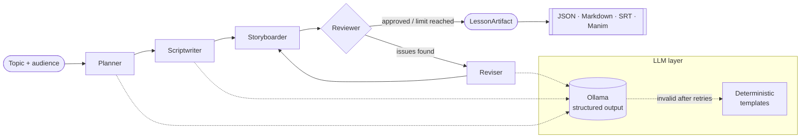

# Codeverse Studio

[](https://github.com/Nouran-Salah/codeverse-studio-starter/actions/workflows/ci.yml)


**A multi-agent LangGraph pipeline that turns a computer-science topic into a production-ready
video plan: lesson plan, narration script, timed storyboard, subtitles, and a Manim scene
skeleton, gated by an automated reviewer with a bounded self-revision loop.**

```bash
codeverse run "How do pointers work in C++?" -f markdown -f srt -f manim
```

→ see the generated output in [`examples/`](examples/): [script](examples/pointers-cpp-beginner.md) ·
[subtitles](examples/pointers-cpp-beginner.srt) · [Manim scenes](examples/pointers-cpp-beginner.py) ·
[full artifact](examples/pointers-cpp-beginner.json)

---

## Highlights

| | |
|---|---|
| **Agentic workflow** | Five LangGraph nodes with typed shared state and a conditional *review → revise* cycle. |
| **Local LLMs** | Ollama provider using JSON-schema **structured outputs**; no paid API keys. |
| **Never crashes on bad model output** | Pydantic validation at every stage, retries that feed the validation error back to the model, and a deterministic fallback per stage, recorded in the artifact. |
| **Explainable quality gate** | Reviewer emits typed issues (`code`, `severity`, `target`) and a 0–100 score; routing never depends on message wording. |
| **Bounded self-correction** | The reviser fixes flagged issues, the storyboard is re-timed, and the reviewer re-checks, up to `max_revisions` times. |
| **Observability** | Each run records provider, model, per-stage latency, revision count, review history and fallbacks. |
| **Multiple interfaces** | Typer CLI, FastAPI service, Docker image, Python API. |
| **Media-ready exports** | JSON, Markdown, SRT subtitles timed from narration length, and runnable Manim scenes. |
| **Tested** | 40+ tests: agent units, reviewer rubric, retry/fallback behaviour, bounded loop, HTTP contract with Ollama, CLI and API. CI on Python 3.11–3.13. |

## Architecture



| Agent | Responsibility | LLM? |
|---|---|---|
| **Planner** | Title, measurable objectives, prerequisites, ordered outline | ✅ with fallback |
| **Scriptwriter** | Spoken narration, one section per outline item, key terms | ✅ with fallback |
| **Storyboarder** | Intro / section / recap scenes, durations derived from word count (~150 wpm) | deterministic |
| **Reviewer** | Rubric of blocking + warning checks, score, approval | deterministic (by design) |
| **Reviser** | Applies reviewer feedback while keeping headings stable | ✅ with fallback |

More detail in [`docs/architecture.md`](docs/architecture.md).

### Design decisions

- **Deterministic reviewer.** The quality gate is code, not a model, so approval is reproducible
  and testable. LLM-as-judge can be added later as an extra signal, not a replacement.
- **Provider protocol + dependency injection.** Agents depend on an `LLMProvider` protocol
  (`complete_json(system, prompt, schema)`), so tests use a scripted `FakeProvider` and new
  backends (OpenAI, Groq, vLLM) are one class each.
- **Graceful degradation over hard failure.** A failed LLM stage falls back to its template and
  is listed in `metadata.fallbacks`, so a run always completes and the output is honest about
  how it was made.
- **Guardrails on model output.** The model cannot change the requested topic or audience, and
  scripts whose headings drift from the outline are rejected and retried.
- **Append-only state channels.** `timings`, `review_history`, and `fallbacks` use LangGraph
  reducers (`operator.add`), so nodes stay pure and only return what they change.

## Quick start

Requires Python 3.11+.

```bash
python -m venv .venv
source .venv/bin/activate          # Windows: .venv\Scripts\Activate.ps1
pip install -e ".[dev,api]"

codeverse run "Binary search" --audience intermediate -f markdown -f srt
pytest
```

Runs fully offline by default (`CODEVERSE_PROVIDER=deterministic`).

### Use a local LLM (Ollama)

```bash
ollama pull qwen3:4b
codeverse doctor                                   # checks server + model
codeverse run "Hash tables" --provider ollama --model qwen3:4b -f markdown -v
```

All settings can also come from environment variables; see [`.env.example`](.env.example).

### CLI

```text
codeverse run TOPIC [--audience beginner|intermediate|advanced]
                    [--provider deterministic|ollama] [--model NAME]
                    [--max-revisions N] [-f json|markdown|srt|manim ...] [-o DIR] [-v]
codeverse doctor
codeverse version
```

`run` exits with code `2` when the lesson still needs revision, so it can gate scripts and CI.

### HTTP API

```bash
make api                     # or: uvicorn codeverse.api:app --reload
curl -X POST localhost:8000/lessons -H 'content-type: application/json' \
     -d '{"topic": "Recursion", "audience": "beginner"}'
curl -X POST localhost:8000/lessons/export/srt -H 'content-type: application/json' \
     -d '{"topic": "Recursion"}'
```

Interactive docs at `http://localhost:8000/docs`. Docker: `docker build -t codeverse . && docker run -p 8000:8000 codeverse`.

### Python

```python
from codeverse.pipeline import generate_lesson
from codeverse.exporters import export

lesson = generate_lesson("Dijkstra's algorithm", "advanced")
print(lesson.review.score, lesson.metadata.timings)
open("dijkstra.py", "w").write(export(lesson, "manim"))   # manim -pql dijkstra.py Scene01
```

## Project structure

```text
src/codeverse/
  agents/       planner, scriptwriter, storyboarder, reviewer, reviser, prompts, rubric
  llm/          provider protocol, structured-output retries, Ollama client
  workflow/     LangGraph graph and typed state
  models/       Pydantic data contracts
  exporters/    JSON, Markdown, SRT, Manim
  api/          FastAPI app (optional extra)
  cli.py        Typer CLI
  pipeline.py   public entry point
tests/          unit, integration and interface tests
examples/       sample generated output
docs/           architecture and roadmap
```

## Testing

```bash
make test     # pytest with coverage
make lint     # ruff check + format check
```

The suite covers the happy path, malformed and invalid model output, transport errors,
retry exhaustion, per-stage fallback, the revision loop repairing a weak script, the loop
stopping at its bound, guardrails on model output, every export format (the Manim export is
parsed as Python), an HTTP contract test against a local fake Ollama server, the CLI, and the API.

## Roadmap

See [`docs/development-plan.md`](docs/development-plan.md). Next up: TTS narration, rendering the
Manim scenes and assembling them with FFmpeg, run persistence, and a React review dashboard.

## Status

Working planning pipeline with local-LLM support. It does **not** render finished videos yet,
and the reviewer checks structure and pacing, not technical accuracy, so a human should review
content before publishing.
